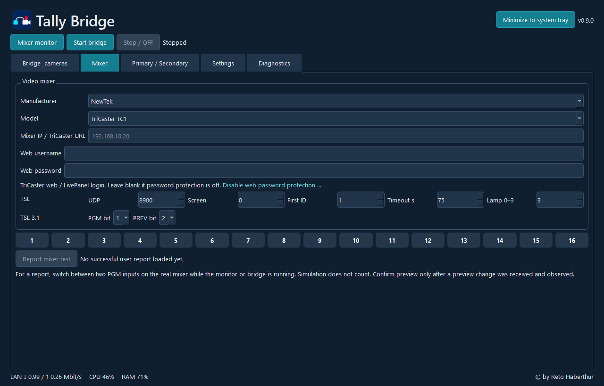

# Tally Bridge
## Screenshot

**Connecting Video Switchers and Cameras**

Tally Bridge is a software project by Habster for integrating tally signals between video switchers and cameras in live video production environments.

It is designed around the need to communicate camera status information between production equipment.

## Download & Documentation

**[Tally Bridge – Official Website](https://www.habster.ch/tally-bridge-die-verbindung-zwischen-videomischer-und-kameras/)**

Visit the official website for information about the software, supported equipment, configuration and downloads.

## What is Tally?

In live video production, tally signals indicate which cameras are currently active.

Common tally states include:

- **Program (PGM):** Camera currently on air.
- **Preview (PVW):** Camera selected for the next transition.
- **Off:** Camera not currently selected for program or preview.

These indicators help camera operators understand how their cameras are being used during a production.

## About Tally Bridge

Tally Bridge focuses on connecting video switchers and cameras within a tally workflow.

The supported devices, communication protocols and configuration options are documented on the official project website.

## Applications

- Live video production
- Multi-camera environments
- Broadcast and studio workflows
- Professional audiovisual installations

## Software & Compatibility

Please refer to the official website for supported operating systems, video switchers, cameras and connection methods.

## License

Tally Bridge is proprietary software (Closed Source).

The source code is not publicly available.

This repository provides project information and links to the official website. It does not contain the application source code.

All rights reserved by the respective copyright holder.

## Deutsche Beschreibung

**Tally Bridge – Die Verbindung zwischen Videomischer und Kameras**

Tally Bridge ist ein Softwareprojekt von Habster zur Integration von Tally-Signalen zwischen Videomischern und Kameras.

Tally-Anzeigen unterstützen Kameraleute bei Liveproduktionen, indem sie den aktuellen Programm- oder Vorschaustatus einer Kamera signalisieren.

Informationen zu den unterstützten Geräten, zur Konfiguration und zur Software findest du auf der offiziellen Projektseite.

**[Weitere Informationen zu Tally Bridge](https://www.habster.ch/tally-bridge-die-verbindung-zwischen-videomischer-und-kameras/)**

---

**Habster Software Tools**

[Official Website](https://www.habster.ch) | [NDI Signal Stabilizer](https://github.com/Habster81/ndi-signal-stabilizer)
